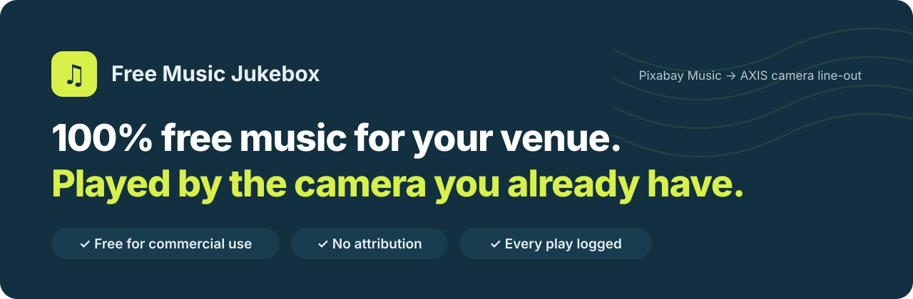
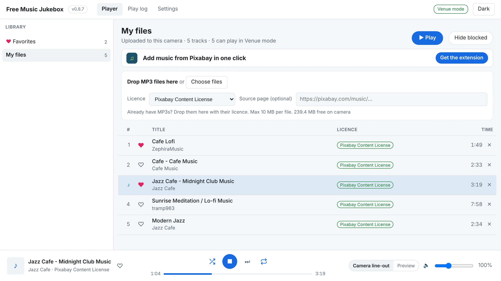
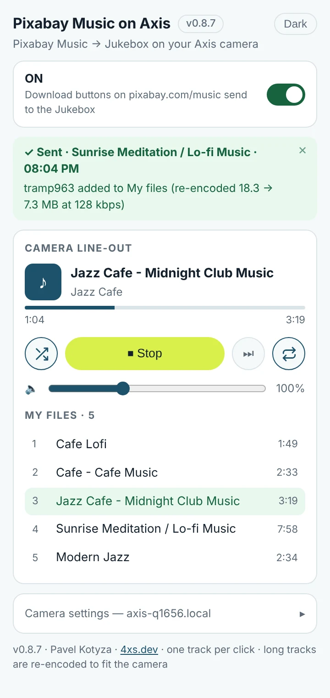
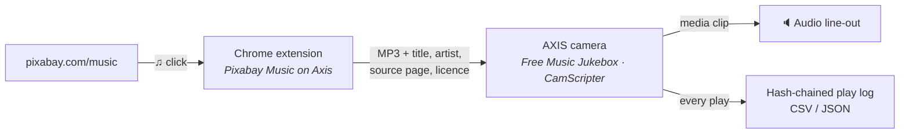

<!--
  Before publishing, replace the placeholder:
  - YOUR-PAGES-URL  → your GitHub Pages address, e.g. https://kotyzap.github.io/free-music-jukebox/
-->

<a href="https://YOUR-PAGES-URL/">
  <picture>
    <source media="(prefers-color-scheme: dark)" srcset="docs/assets/banner-dark.svg">
    
  </picture>
</a>

<p align="center">
  <a href="../../releases/latest"></a>
  
  
  
  
</p>

<p align="center">
  <b>Pick tracks on <a href="https://pixabay.com/music/">Pixabay Music</a>, click ♫, and they play from your AXIS camera’s audio line-out.</b><br>
  No subscription, no per-track fee, no attribution — and a log of every play with its licence.
</p>

<p align="center">
  <a href="../../releases/latest"><b>⬇ Download</b></a> ·
  <a href="https://YOUR-PAGES-URL/">Website</a> ·
  <a href="#-install">Install</a> ·
  <a href="#-compare">Compare</a> ·
  <a href="#-licensing">Licensing</a> ·
  <a href="https://YOUR-PAGES-URL/?lang=cs">Česky</a> ·
  <a href="https://YOUR-PAGES-URL/?lang=ja">日本語</a> ·
  <a href="https://YOUR-PAGES-URL/?lang=de">Deutsch</a>
</p>

<p align="center">
  <a href='https://ko-fi.com/K3K6RR4LY' target='_blank'></a>
</p>

<br>

<table>
  <tr>
    <td width="68%" valign="top">
      <picture>
        <source media="(prefers-color-scheme: dark)" srcset="docs/assets/camera-dark.webp">
        
      </picture>
      <p align="center"><sub><b>Camera page</b> — library, player, play log and settings, served by the camera itself</sub></p>
    </td>
    <td width="32%" valign="top">
      <picture>
        <source media="(prefers-color-scheme: dark)" srcset="docs/assets/popup-dark.webp">
        
      </picture>
      <p align="center"><sub><b>Extension popup</b> — same player, from your browser</sub></p>
    </td>
  </tr>
</table>

## ✦ Why it’s free

**The licence is the feature.** Every track comes from [Pixabay Music](https://pixabay.com/music/) under the [Pixabay Content License](https://pixabay.com/service/license-summary/). Here is what that licence lets a business do — and the one thing it doesn’t.

<table>
  <tr>
    <td width="33%" valign="top">
      <h3>✓ Commercial use is allowed</h3>
      Play it in your café, gym, shop or waiting room. No business tier to buy, no per-location price.
    </td>
    <td width="33%" valign="top">
      <h3>✓ No attribution required</h3>
      Nothing to announce, nothing to put on a poster. The Jukebox still records the artist and source page for you.
    </td>
    <td width="33%" valign="top">
      <h3>✓ Free to download</h3>
      No account fee, no per-download price. You pick a track, Pixabay hands it over, the camera plays it.
    </td>
  </tr>
</table>

> [!IMPORTANT]
> **The one rule:** you may not sell or redistribute the tracks as they are. That’s why each track stays on your camera and is never shared, re-uploaded or offered for download.

## ✦ Compare

A personal streaming app is the easy choice — and the one its own terms rule out for a business.

| | Music cost | OK in a business? | Hardware | Proof of what played |
|---|---|---|---|---|
| Personal streaming app | Monthly subscription | ✗ No — personal use only | Phone or PC + speaker | None |
| Business music service | Monthly fee per location | Yes, licensed by the provider | Their player box or app | Depends on the provider |
| **Free Music Jukebox + Pixabay** | **$0** | **✓ Commercial use allowed\*** | **Your AXIS camera + a speaker** | **Tamper-evident log, CSV/JSON** |

<sub>\* See <a href="#-licensing">Licensing</a> — collecting societies are a separate question.</sub>

## ✦ How it works

<table>
  <tr>
    <td width="33%" valign="top">
      <h3>01 · Click ♫ on Pixabay</h3>
      The Chrome extension turns every Download button on <a href="https://pixabay.com/music/">pixabay.com/music</a> into ♫. Pixabay’s own download runs — one track per click, as Pixabay’s terms expect.
    </td>
    <td width="33%" valign="top">
      <h3>02 · It lands on the camera</h3>
      Title, artist, source page and licence are stored with the file. Long tracks are re-encoded in your browser to fit the camera’s 10 MB clip limit.
    </td>
    <td width="33%" valign="top">
      <h3>03 · It plays from the line-out</h3>
      Plug a speaker into the camera’s audio out. Shuffle, next and loop from the camera page or the extension — one shared player.
    </td>
  </tr>
</table>



## ✦ Play log — free music you can account for

If anyone asks what was playing, you can show them.

- **Every play recorded** — time, track, artist, licence, source page, seconds played.
- **Tamper-evident** — daily logs are hash-chained; *Verify chain* shows if anything was changed.
- **Venue mode** — only tracks with a commercial-use licence are allowed to play. *Lab mode*, for testing, plays anything and logs it as non-commercial.

| Start | Track | Artist | Licence | Sec |
|---|---|---|---|---:|
| 19:40:01 | Jazz Cafe - Midnight Club Music | Jazz Cafe | Pixabay Content License | 199 |
| 19:36:42 | Sunrise Meditation / Lo-fi Music | tramp963 | Pixabay Content License | 478 |
| 19:34:09 | Cafe - Cafe Music | Cafe Music | Pixabay Content License | 153 |
| 18:33:26 | Cafe Lofi | ZephiraMusic | Pixabay Content License | 110 |

<sub>Example rows from the Play log tab (newest first). Exports keep play order so the hash chain can be verified.</sub>

## ✦ Install

**You need:** an AXIS camera with an audio line-out and a powered speaker · [CamScripter App](https://camstreamer.com) 1.5.3 or newer on the camera · Google Chrome on a computer in the same network.  
Tested on **AXIS Q1656** (ARTPEC-8).

1. Download `free_music_jukebox_x.y.z.zip` from [**Releases**](../../releases/latest) and install it in **CamScripter**.
2. Open the app, go to **Settings** and enter a camera user it can use to play audio clips. Save.
3. In **My files** click **Get the extension**, unzip it, open `chrome://extensions`, turn on **Developer mode** and choose **Load unpacked**.
4. Click the extension icon, enter the camera address, user and password, **Save** — then click ♫ on [pixabay.com/music](https://pixabay.com/music/).

> [!TIP]
> After you update the extension, reload any Pixabay tab that was already open — the ♫ buttons in old tabs stop working until you do.

## ✦ Good to know

- **No pause or seek on the speaker.** The camera’s media-clip API can only start a clip or stop it.
- **Tracks up to about 20 minutes** — what fits in a 10 MB clip at 64 kbps. Shorter tracks are uploaded untouched.
- **One track per click, on purpose.** Pixabay’s terms don’t allow bulk downloading.
- **The extension is loaded unpacked;** it is not in the Chrome Web Store.
- **One version number.** Free Music Jukebox X.Y.Z always ships Pixabay Music on Axis X.Y.Z; the popup warns if the camera runs a different version.

## ✦ Licensing

The Pixabay Content License allows commercial use without attribution. Whether a venue *also* needs a licence from a collecting society — **ASCAP, BMI, SESAC** or **GMR** in the US, **GEMA** in Germany, **OSA** in Czechia, **JASRAC** in Japan — depends on the country and on the individual track.

Free Music Jukebox does not promise that no fees apply. It keeps a tamper-evident record of what played, where it came from and under which licence, so you can show it.

> [!NOTE]
> This is not legal advice.

<details>
<summary><b>Repository layout & building from source</b></summary>

<br>

| Path | What |
|---|---|
| [`free_music_jukebox/`](free_music_jukebox/) | CamScripter app (TypeScript): player, library, play log, camera UI |
| [`Pixabay Music on Axis/`](Pixabay%20Music%20on%20Axis/) | Chrome extension (Manifest V3): ♫ buttons, upload, popup player |
| [`docs/`](docs/) | GitHub Pages one-pager (EN / CZ / JP / DE) |

```sh
cd free_music_jukebox
npm ci                  # once
npm run zip:package     # zips the extension into html/, compiles, builds free_music_jukebox_x.y.z.zip
```

Install the resulting zip in CamScripter. The build uses the TypeScript version pinned in `package-lock.json`.

</details>

<br>

<p align="center">
  <a href='https://ko-fi.com/K3K6RR4LY' target='_blank'></a>
</p>

<p align="center">
  <b>Pavel Kotyza</b> · <a href="https://4xs.dev">4xs.dev</a> · <i>I teach Axis cameras new tricks!</i><br>
  <sub>Not affiliated with Axis Communications or Pixabay. AXIS is a trademark of Axis AB. Bundles <a href="https://github.com/zhuker/lamejs">lamejs</a> (LGPL) for MP3 encoding.</sub>
</p>
